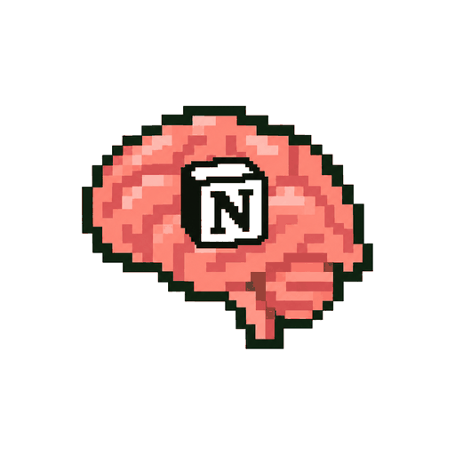

<p align="center"></p>

# guava-stack: AI brain + router + rules

<p align="center"><a href="https://skills.sh/romeodiaz/guava-stack"></a></p>

**Free, open source, and yours to keep.**

Your business context, rules, skills and AI memories in one place you already own. You drive everything from Grok Bot or Muse, on any device. No code needed: paste one line into your bot and it sets it up.

**🧭 Opinionated defaults.** guava-stack is one setup, tested end to end on the way Guava works every day. It's all plain Markdown skills, so you can still hack it to fit anyone.

**🔑 You'll need:**
- Grok Bot ($30 plan or higher)  or Muse Bot (Free) 
- Claude Pro  or ChatGPT Plus  ($20 plan or higher)<br>Your bot can run both behind the scenes
- Notion (Free) 

## What you get

### 1) AI brain
<table>
<tr>
<td align="center" width="200"><a href="guava-hub/"></a></td>
<td><ins>guava-hub (Notion)</ins><br>One home in your own Notion workspace for your context, rules, skills and memories. Your bot reads it and remembers into it, and so does any other assistant you connect.</td>
</tr>
</table>

Your Notion guava-hub has four parts:

<table>
<tr>
<td align="center" width="200"> <br><strong>context</strong></td>
<td><ins>Your settings and who you are</ins><br>Starts with your guava-stack settings, where guava-router lives: your head-chef and line-cook models, plus the rules you've turned on. Change a model there and every assistant follows it. Then who you are: your business, customers, offers, voice and tools, filled in from a short interview at setup.</td>
</tr>
</table>

<table>
<tr>
<td align="center" width="200"><br><strong>rules</strong></td>
<td><ins>How your AI works for you</ins><br>Your own rules, plus any rules skill you turn on, such as founder-mode. Each set is saved word for word in its own section, and every assistant follows them.</td>
</tr>
</table>

<table>
<tr>
<td align="center" width="200"><br><strong>skills</strong></td>
<td><ins>What your AI reuses</ins><br>A Notion database of step-by-step instructions your assistants reuse, such as writing a post in your voice or onboarding a client. You choose which ones are on.</td>
</tr>
</table>

<table>
<tr>
<td align="center" width="200"><br><strong>memories</strong></td>
<td><ins>What your AI learned</ins><br>Notion Memory: the decisions, corrections and preferences your assistants pick up as they work, in one place every assistant shares, so Grok Bot, Muse and anything else you connect remember the same things. Each app can move its own memories in, and you can say "forget" anything to remove it.</td>
</tr>
</table>

### 2) router
<table>
<tr>
<td align="center" width="200"><a href="guava-router/"></a></td>
<td><ins>guava-router</ins><br>Your bot sends each job to the best AI model on the plans you already pay for, split like a kitchen.</td>
</tr>
</table>

<!-- models:kitchen size=80 -->
<table>
<tr>
<td align="center" width="50%"><br><strong>head-chef</strong><br><sub>Today's best: Claude Opus 5.5 <br>Next best: GPT-6 Astra </sub></td>
<td align="center" width="50%"><br><strong>line-cook</strong><br><sub>Today's best: GPT-6.1 Sol <br>Next best: Claude Sonnet 5.5 </sub></td>
</tr>
<tr>
<td>Orchestration, research, planning, brainstorming, copywriting, validation, review, verification, fuzzy and hard problems.</td>
<td>Bulk execution, coding, sub-agent tasks, worker threads, long-running jobs.</td>
</tr>
</table>
<!-- /models -->

### 3) rules
<table>
<tr>
<td align="center" width="200"><a href="founder-mode/"></a></td>
<td><ins>founder-mode</ins><br>27 working rules. Your AI does the safe work itself, writes like a human, and asks before anything costly or permanent.</td>
</tr>
</table>

## Why people use it
- 🗣️ **Explain your business once.** Every assistant already knows it.
- 💳 **Uses the plans you have.** Claude, ChatGPT or both do the work, and Muse is free.
- 📱 **Everywhere.** Your bot works the same on your desk, laptop and phone.
- 🔓 **No lock-in.** It lives in your own Notion account.
- 🆓 **Free and open source.** MIT licensed.
- 🔒 **Private.** Guava never sees your data.
- 🛡️ **Safe for your AI accounts.** No shared or proxied logins that could get your accounts banned. Each AI runs in its official tool, signed in as you.
- ✅ **Safe by default.** Shows every change first, never overwrites, and checks outside skills before installing.

## Start here
Paste this into Grok Bot or Muse:

```
Set me up by following the Start here steps in github.com/romeodiaz/guava-stack.
```

It asks a few questions, explains each step, and checks that everything works. Unsure? Say "use the defaults".

Each bot follows its own guide: [Grok Bot](assistants/grok.md) · [Muse](assistants/muse.md).

**AI assistants:** first check `assistants/<your assistant>.md` for steps to skip or change. If there's no file for you, tell the owner Guava doesn't support that assistant yet. Then follow [guava-hub/skills/guava-hub/SKILL.md](guava-hub/skills/guava-hub/SKILL.md) from step 1. It builds the hub, hands off to the router, offers founder-mode and wraps up.

**🧩 Just want one piece?** Each works on its own:

```
Install guava-hub from github.com/romeodiaz/guava-stack
```

```
Install guava-router from github.com/romeodiaz/guava-stack
```

```
Install founder-mode from github.com/romeodiaz/guava-stack
```

On Grok Bot:

```
npx skills add romeodiaz/guava-stack -g -y
```

For one piece, add `--skill <name>`.

**▶️ Try it:**
1. "Set me up."
2. "Import my existing instructions and skills into my guava-hub."
3. "Turn on founder-mode."
4. "Write this week's LinkedIn post in my voice."

## Some Manual Setup Needed
Setup walks you through each of these, since your bot can't do them for you. If your bot seems to ignore your hub, check these first:
- **Sign-ins:** you approve Notion, Claude and ChatGPT in your browser when your bot asks, and paste any code straight back into the bot.
- **Muse:** the guava lines at the end of SOUL.md (the bot's avatar, then the Fingerprint tab).
- **Updates:** say "update guava-stack" in each bot you use, since only it can change its own memory.

## How to update
Say **"update guava-stack"**. It updates every piece and your hub, offers newer models, and shows the plan first. For one piece, say **"update guava-hub"**, **"update guava-router"** or **"update founder-mode"**. Say it in Grok Bot or Muse. 📜 [Changelog](founder-mode/CHANGELOG.md)

## How to uninstall
Say **"uninstall guava-stack"** to take every piece off and put each assistant back the way it was. For one piece, say **"uninstall guava-hub"**, **"uninstall guava-router"** or **"uninstall founder-mode"**. It shows the plan first, removes only what Guava added (using the `.pre-guava` copies setup keeps), and leaves your hub's pages and files alone, since they're yours. If your assistant doesn't know the command, paste this:

```
Uninstall guava-stack by following the Uninstall steps in github.com/romeodiaz/guava-stack.
```

## Your data stays yours
🔒 Guava collects nothing. Your details go only to your own hub, and your AI work only to the AI services you already use. Setup asks before every change.

<details>
<summary><strong>See exactly what setup touches</strong></summary>

- **Files edited:** on your bot's own computer, `~/.claude/settings.json` and `~/.codex/config.toml`, each backed up first, with a `.pre-guava` copy kept from before Guava's first change. Setup adds only each tool's model and, if you want it, the hub's read-only tools from the optional "Never skip the hub" step.
- **Commands run:** only what's missing, on your bot's computer: `npm i -g @anthropic-ai/claude-code`, `npm i -g @openai/codex`, `claude auth login`, `codex login --device-auth`, and a quick test prompt in each.
- **Files read:** only the instruction, skill or notes files you approve. Never your bot's memories or chats. Each bot can move its own memories into Notion Memory if you ask it to.
- **Saved:** your hub, plus standing instructions in your bot's memory (Grok Bot) or SOUL.md (Muse). Assistants also save what they learn about your work (decisions, corrections, preferences) to Notion Memory in your own workspace, never passwords or keys. Say "forget" anything to remove it.
- **Undo it all:** "uninstall guava-stack" undoes every change above and keeps your hub, which stays yours to keep or delete. It asks before removing a connector or AI tool you might use for other work.
- **External services:** Notion, your AI providers, and GitHub. Nothing goes to Guava, and the plugin fetches no remote instructions. [Privacy](https://workwithguava.com/privacy)

</details>

## What's inside
- 🧠 **[guava-hub](guava-hub/)**: hub setup, with the [Notion steps](guava-hub/skills/guava-hub/backends/notion.md).
- 🔀 **[guava-router](guava-router/)**: model routing through Claude Code and Codex, which your bot runs for you.
- 🎤 **[founder-mode](founder-mode/)**: the rules and their [changelog](founder-mode/CHANGELOG.md).
- 🤖 **[assistants/](assistants/)**: what Grok Bot and Muse each skip or change.
- 🛠️ **Know agent files?**
  - context ≈ USER.md + TOOLS.md.
  - rules ≈ the rules in AGENTS.md or CLAUDE.md, shared by every assistant.
  - skills = the `skills/` folder.
  - Setup does BOOTSTRAP.md's job, once.
  - MEMORY.md ≈ Notion Memory: what assistants learn goes there, outside the hub.
  - Its short About page loads at start-up, and the rest is looked up when a task needs it.
  - No SOUL.md, IDENTITY.md or HEARTBEAT.md: each assistant keeps its own persona and check-ins.

## Support
- ✉️ [romeo@workwithguava.com](mailto:romeo@workwithguava.com)
- 🔒 [Privacy](https://workwithguava.com/privacy)
- 👥 Want it for your whole team? [Book a call](https://workwithguava.com/talk)

## Credits
Adapted from [poteto-mode](https://github.com/cursor/plugins/blob/main/pstack/skills/poteto-mode/SKILL.md) in Cursor's pstack plugin, by poteto, from [Matt Pocock's skills](https://github.com/mattpocock/skills) and the [humanizer skill](https://github.com/blader/humanizer) by blader. founder-mode takes its name and spirit from Paul Graham's essay [Founder Mode](https://paulgraham.com/foundermode.html), and the Notion hub setup draws on Notion's [Set up Notion for your agent](https://developers.notion.com/prompts/setup).

Built by Romeo Diaz to run Guava ([workwithguava.com](https://workwithguava.com)). Follow @romeodiazai on LinkedIn and X.

## License
MIT. Free to use, change and share. See [LICENSE](LICENSE).
