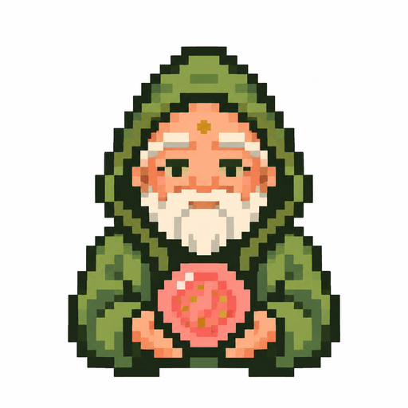

<p align="center"></p>

# guava-stack

Notion as the shared memory and workspace for Claude and ChatGPT, in their desktop apps and in Claude Code and Codex. Built on Notion's official setup guide for agents, [Set up Notion for your agent](https://developers.notion.com/prompts/setup).

## Start here
Tell your agent this, in the Claude or ChatGPT desktop app, or in Claude Code or Codex:

```
Set this up https://workwithguava.com/guava-stack
```

You'll need a Claude  or ChatGPT  plan and Notion . Notion's free plan works for one person. A team needs a paid Notion plan, since a Free workspace with more than one member stops at 1,000 blocks for good.

**Prefer clicking?** Start from the [guava-hub template](https://guava-hub.notion.site/guava-hub-409a1a34268a810c8951f9a75a9e5c8a): click **Duplicate**, then tell your agent the line above.

**AI assistants:** follow [skills/guava-stack/SKILL.md](skills/guava-stack/SKILL.md).

## What it does
Notion's guide does the setup: it connects Notion, makes your private Agent Operating Guide (where your things live, your preferences and a version history), gives every app the same custom instructions, offers a daily memory and setup check, and brings in the memories, documents and skills you already have.

guava-stack adds what Notion's guide leaves to each app: connecting Claude Code and Codex to Notion, saving the same custom instructions where they read them, and adding your other apps, so all four read the same Notion.

Here's what you end up with in your Notion. Notion's guide makes the first two, and guava-stack adds the work map, router settings and optional task log to your Agent Operating Guide. Guava's parts come on one short plan and one yes, and founder-mode is always on and yours to change:

<table>
<tr>
<td align="center" width="200"><span style="font-size:64px">🧭</span><br><strong>Agent Operating Guide</strong></td>
<td>Your private map for every agent: where each kind of work lives, in Notion or the apps you already use, such as Linear, HubSpot or Google Drive, one line for each place, plus your preferences and router settings. Your AI files work where the map says. Nothing moves, and a Notion database is only offered for work that has no home yet. Optionally, your AI logs the bigger work you'd track as tasks, wherever your tasks live, with each task's ID in commits, PRs and hand-offs.</td>
</tr>
<tr>
<td align="center"><span style="font-size:64px">💭</span><br><strong>Memories</strong></td>
<td>What your assistants learn about you, shared across every app: a short About page and one page for each topic. It starts with the memories your apps can already see, and you can read and edit all of it.</td>
</tr>
</table>

<table>
<tr>
<td align="center" width="200"><br><strong>guava-hub</strong></td>
<td>One page in your sidebar holding your context, your rules and Notion's Skills library.</td>
</tr>
<tr>
<td align="center"><br><strong>context</strong></td>
<td>Your work, who it serves and your voice, drafted from your website or LinkedIn, with a link for each fact. Who you are stays on Notion's own About page.</td>
</tr>
<tr>
<td align="center"><br><strong>rules</strong></td>
<td>Your working preferences and the rules skills you turn on, such as founder-mode, word for word.</td>
</tr>
</table>

<table>
<tr>
<td align="center" width="200"><br><strong>routines</strong></td>
<td>The scheduled tasks in your Claude and ChatGPT apps, recorded in Notion's Skills library next to the skill each one runs: when it runs, where, what you approved ahead of time and when it last ran. Say "check my routines" anytime.</td>
</tr>
</table>

<table>
<tr>
<td align="center" width="200"><a href="skills/founder-mode/SKILL.md"></a><br><strong>founder-mode</strong></td>
<td><a href="skills/founder-mode/SKILL.md">16 working rules</a>. Your AI does the safe work itself, checks the real result and asks before anything costly or permanent. The four safety rules go in your custom instructions, so they always hold. Always on; change any rule on your rules page.</td>
</tr>
</table>

<table>
<tr>
<td align="center" width="200"><br><strong>starter skills</strong></td>
<td>Saved in Notion's Skills library, so every app can use them. Drop any you don't want.</td>
</tr>
<tr>
<td align="center"><a href="skills/workflow-review/SKILL.md"></a><br><strong>1. workflow-review</strong></td>
<td>Ranks which of your workflows are worth automating, as a report that stays on your computer.</td>
</tr>
<tr>
<td align="center"><a href="skills/design-cook-off/SKILL.md"></a><br><strong>2. design-cook-off</strong></td>
<td>For a page people judge by its look, your AI builds it twice with two design skills, and you pick one.</td>
</tr>
<tr>
<td align="center"><a href="https://github.com/blader/humanizer"></a><br><strong>3. humanizer-writing</strong></td>
<td>From blader's <a href="https://github.com/blader/humanizer">humanizer</a>, so anything your AI writes doesn't sound like AI.</td>
</tr>
<tr>
<td align="center"><a href="https://github.com/DietrichGebert/ponytail"></a><br><strong>4. ponytail-coding</strong></td>
<td>From Dietrich Gebert's <a href="https://github.com/DietrichGebert/ponytail">ponytail</a>: your AI writes the least code that does the whole job.</td>
</tr>
<tr>
<td align="center"><a href="skills/oracle-council/SKILL.md"></a><br><strong>5. oracle-council</strong></td>
<td>Three top AIs from three companies answer one hard question at once, merged into one verdict. Gemini 4 Argon runs on OpenRouter, billed per use.</td>
</tr>
<tr>
<td align="center"><a href="skills/guava-router/SKILL.md"></a><br><strong>6. guava-router</strong></td>
<td>In Claude Code or Codex, work is split like a kitchen:<br> the <strong>head-chef</strong> (Claude Opus 5.5) plans, writes and reviews<br> the <strong>line-cook</strong> (GPT-6.1 Sol) does the bulk work and coding</td>
</tr>
<tr>
<td align="center"><a href="skills/oracle-research/SKILL.md"></a><br><strong>7. oracle-research</strong></td>
<td>What people and the web have said about a topic in the last 30 days, as a short cited answer in the chat. Gemini 4 Argon searches Reddit, Hacker News, YouTube and the web through OpenRouter's Perplexity and Exa search, ranked by relevance and engagement, with only its findings coming back to your computer. About $0.30 a run.</td>
</tr>
</table>

**Just want oracle-council or oracle-research?** Tell any AI agent that can run commands on your computer: `Set up oracle-council from github.com/romeodiaz/guava-stack (skills/oracle-council)`, or the same with oracle-research. One OpenRouter key covers both, with no subscriptions needed. In a chat app with no terminal, it runs as a council by hand: you paste one briefing into two other companies' AI apps.

## What it changes
- **In Notion:** what Notion's guide makes, plus the guava-hub pages, a Notion database only for a kind of work that has no home yet, the Routines columns and view in the Skills library, the skills you pick, and a few preference lines and a guava-stack settings section in your Agent Operating Guide, all named in the plan you say yes to.
- **On your computer:** the custom instructions at the end of `~/.claude/CLAUDE.md` and Codex's global `AGENTS.md` (in `~/.codex`), a Notion connection in Claude Code or Codex if there isn't one yet, and with oracle-council or oracle-research, the OpenRouter key their browser sign-in makes, in `~/.config/guava-stack/openrouter-key`.
- **In the desktop apps:** the custom instructions you paste into Claude's or ChatGPT's settings.

## Update and uninstall
Say **"update guava-stack"** or **"uninstall guava-stack"**. Each shows the change first and waits for your yes. Uninstalling removes the custom instructions from your computer and leaves everything in your Notion as it is.

## For teams
Want it for your whole team? Guava sets up an Enterprise version for teams and companies: one shared setup in Notion, with everyone's assistants on the same rules and skills. Not on Notion? Guava also builds custom guava-stacks on Microsoft 365 (SharePoint and OneDrive), Google Workspace (Google Drive), Obsidian or your own private AWS or Azure VPC. [Book a call](https://workwithguava.com/talk).

## Credits
Built on Notion's [Set up Notion for your agent](https://developers.notion.com/prompts/setup). guava-stack isn't made or endorsed by Notion. Notion is a trademark of Notion Labs, Inc.

Built by Romeo Diaz ([workwithguava.com](https://workwithguava.com)).

## License
MIT. See [LICENSE](LICENSE).
