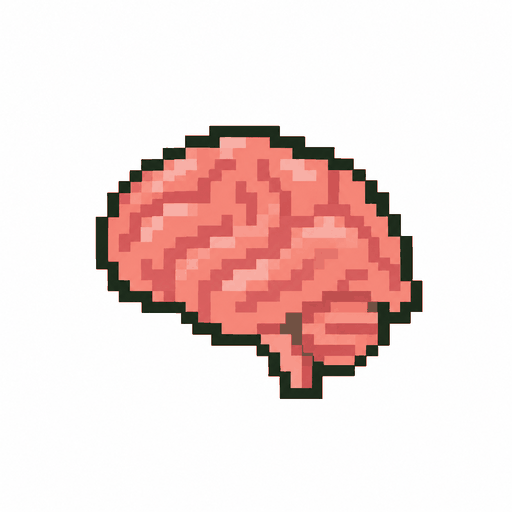
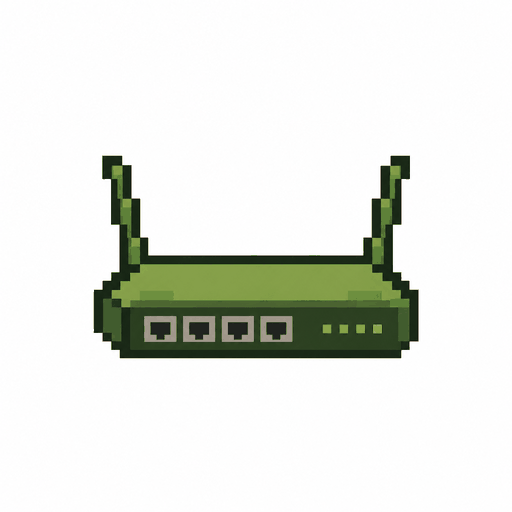
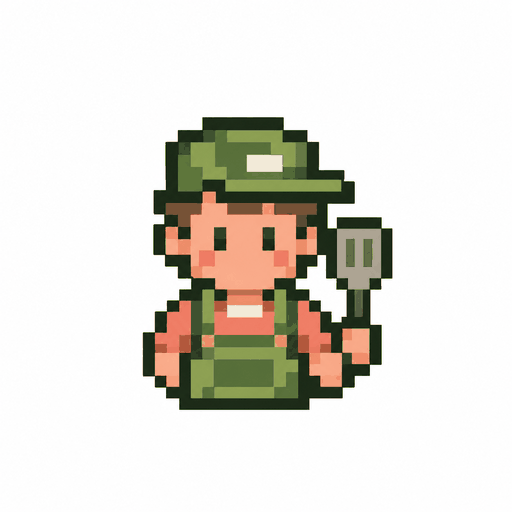

<p align="center"></p>

# guava-stack: AI brain + router + rules

<p align="center"><a href="https://skills.sh/romeodiaz/guava-stack"></a></p>

**Free, open source, and yours to keep.**

Your business context, rules and skills in one place you already own. Every AI assistant reads from it, on every device. No code needed: paste one line and your assistant sets it up.

**🧭 Opinionated defaults.** guava-stack is one setup, tested end to end on the way Guava works every day. It's all plain Markdown skills, so you can still hack it to fit anyone.

**🔑 You'll need:**
- Claude Pro and ChatGPT Plus ($20 a month each) or higher
- Notion Free\*
- Optional: Grok Bot, on a $30 a month xAI or Cursor plan, or Meta's Muse Bot, which is free

<sub>\* Notion's free plan is all you need.</sub>

## What you get
Start with the hub. The other two are optional.

<table>
<tr>
<td align="center" width="33%"><a href="guava-hub/"></a><br><strong>AI brain</strong><br><sub>guava-hub</sub></td>
<td align="center" width="33%"><a href="guava-router/"></a><br><strong>Router</strong><br><sub>guava-router (optional)</sub></td>
<td align="center" width="33%"><a href="founder-mode/"></a><br><strong>Rules</strong><br><sub>founder-mode (optional)</sub></td>
</tr>
<tr>
<td>One home for your context, rules and skills. Every assistant you connect reads it.</td>
<td>Sends each job to the best AI model on the plans you already pay for.</td>
<td>27 working rules. Your AI does the safe work itself, writes like a human, and asks before anything costly or permanent.</td>
</tr>
</table>

Your hub has three parts:

<table>
<tr>
<td align="center" width="33%"><br><strong>context</strong><br><sub>Who you are, your business, your tools</sub></td>
<td align="center" width="33%"><br><strong>rules</strong><br><sub>How your AI should work for you</sub></td>
<td align="center" width="33%"><br><strong>skills</strong><br><sub>Step-by-step instructions your AI reuses</sub></td>
</tr>
</table>

## Why people use it
- 🗣️ **Explain your business once.** Every assistant already knows it.
- 💳 **Nothing new to buy.** Claude, ChatGPT and Notion, plus Grok Bot or Muse if you like, on the plans you already have.
- 📱 **Everywhere.** The same context and rules on your desk, laptop and phone.
- 🔓 **No lock-in.** It lives in your own Notion account.
- 🆓 **Free and open source.** MIT licensed.
- 🔒 **Private.** Guava never sees your data.
- 🛡️ **Safe for your AI accounts.** No shared or proxied logins. Each AI runs in its official app, signed in as you.
- ✅ **Safe by default.** Shows every change first, never overwrites, and scans outside skills before installing.

## Start here
Paste this into a Local session in the Claude desktop app's Code tab (or into Grok Bot or Muse):

```
Set me up by following the Start here steps in github.com/romeodiaz/guava-stack.
```

It asks a few questions, explains each step, and checks that everything works. Unsure? Say "use the defaults".

Each assistant follows its own guide: [Claude](assistants/claude.md) · [ChatGPT and Codex](assistants/chatgpt.md) · [Grok Bot](assistants/grok.md) · [Muse](assistants/muse.md).

**AI assistants:** first check `assistants/<your assistant>.md` for steps to skip or change. If there's no file for you, tell the owner Guava doesn't support that assistant yet. Then follow [guava-hub/skills/guava-hub/SKILL.md](guava-hub/skills/guava-hub/SKILL.md) from step 1. It builds the hub, hands off to the router, offers founder-mode and wraps up.

**🧩 Just want one piece?** Each works on its own:

```
Install guava-hub from github.com/romeodiaz/guava-stack
```

```
Install guava-router from github.com/romeodiaz/guava-stack
```

```
Install founder-mode from github.com/romeodiaz/guava-stack
```

As plugins, in Claude Code: `claude plugin marketplace add romeodiaz/guava-stack`, then `/plugin install <name>@guava`. In Codex: `codex plugin marketplace add romeodiaz/guava-stack`, then `codex plugin add <name>@guava`.

On Grok Bot: `npx skills add romeodiaz/guava-stack -g -y`, or add `--skill <name>` for one piece.

**▶️ Try it:**
1. "Set me up."
2. "Import my existing instructions and skills into my guava-hub."
3. "Turn on founder-mode."
4. "Write this week's LinkedIn post in my voice."

## What only you can do
Setup and updates handle everything on your computer. These live in your app accounts, where no assistant can reach, so setup walks you through each one and every update ends by listing any that changed. If an assistant seems to ignore your hub, check these first:
- **Claude app:** Notion turned on under [Connectors](https://claude.ai/customize/connectors), and Settings → Account → Instructions for Claude holds `Load my guava-hub in Notion first.` Replace any older Guava line there, such as one naming an "AI Context Hub".
- **ChatGPT:** Notion connected under [Plugins](https://chatgpt.com/plugins), and the same line in [Custom Instructions](https://chatgpt.com/settings/personalization), in both the ChatGPT box and the Codex box.
- **Codex:** approve guava-hub's hooks in the small yellow notice under the message box, and again when an update adds one.
- **Grok Bot and Muse:** say "update guava-stack" in the bot itself, since only it can change its own memory.
- **Notion:** the skills database icon (hover its title, Add icon, Link).

## Make it yours
Your choices live in a short **guava-stack settings** section in your hub. Edit anything in your hub, from a model to a rule, and every assistant picks it up within 15 minutes, even in a chat that's already open. Typos get caught with a suggested fix. For bigger changes, say "change my setup".

**💬 Who you talk to**

- **Claude desktop app, Code tab** (Local sessions): where you work. Claude plans and hands work to Codex itself. No terminal needed, and Remote Control opens your sessions from the Claude phone app.
- **Grok Bot or Muse** (optional): cloud assistants that hand each job to the right AI when you're away from your computer. Muse is free.
- **Claude and ChatGPT apps** (web, desktop, phone): read the same hub, on whatever model you pick.

On your computer, your assistant keeps a copy of your hub, so it starts instantly. Everywhere else, it reads the same hub straight from Notion, so a chat's first reply takes a few seconds longer.

*Coming soon:* Google Drive and OneDrive hubs, Claude-only and ChatGPT-only plans, local models, and more agents through [acpx](https://github.com/openclaw/acpx).

**👩‍🍳 head-chef and line-cook**

Split the work like a kitchen.

<!-- models:kitchen -->
<table>
<tr>
<td align="center" width="50%"><br><strong>head-chef</strong><br><sub>Today's best: Claude Opus 5.5</sub></td>
<td align="center" width="50%"><br><strong>line-cook</strong><br><sub>Today's best: GPT-6.1 Sol</sub></td>
</tr>
<tr>
<td>Orchestration, research, planning, brainstorming, copywriting, validation, review, verification, fuzzy and hard problems.</td>
<td>Bulk execution, coding, sub-agent tasks, worker threads, long-running jobs.</td>
</tr>
</table>
<!-- /models -->

Any Claude model works as head-chef and any OpenAI model as line-cook. Say "check for newer models" to swap in better ones as they come out.

## How to update
Say **"update guava-stack"**. It updates every piece and your hub, offers newer models, and shows the plan first. For one piece, say **"update guava-hub"**, **"update guava-router"** or **"update founder-mode"**. In the Claude desktop app, use a Local Code tab session. 📜 [Changelog](founder-mode/CHANGELOG.md)

## How to uninstall
Say **"uninstall guava-stack"** to take every piece off and put each assistant back the way it was. For one piece, say **"uninstall guava-hub"**, **"uninstall guava-router"** or **"uninstall founder-mode"**. It shows the plan first, removes only what Guava added (using the `.pre-guava` copies setup keeps), and leaves your hub's pages and files alone, since they're yours. If your assistant doesn't know the command, paste this:

```
Uninstall guava-stack by following the Uninstall steps in github.com/romeodiaz/guava-stack.
```

## Your data stays yours
🔒 Guava collects nothing. Your details go only to your own hub, and your AI work only to the AI services you already use. Setup asks before every change.

<details>
<summary><strong>See exactly what setup touches</strong></summary>

- **Files edited:** `~/.claude/settings.json` and `~/.codex/config.toml`, each backed up first, with a `.pre-guava` copy kept from before Guava's first change. Setup adds only the hub's local copy in `~/.guava-hub`, each tool's model and, if you want it, Remote Control; the optional "Never skip the hub" step adds only the hub's read-only tools.
- **Start-up hook:** the guava-hub plugin adds a short "load my hub" note to each new Claude Code and Codex session. It changes nothing. A fourth hook asks the session to save what it learned to Notion Memory at the end of long work. Codex asks you once to approve them, named "guava-stack: hub instructions", "hub context", "hub rules" and "save to memory". In the ChatGPT desktop app that's a small yellow notice with a hook icon in the bar under the message box, easy to miss, so click it and approve them all.
- **Commands run:** only what's missing: `npm i -g @anthropic-ai/claude-code`, `npm i -g @openai/codex`, `claude auth login`, `codex login --device-auth`, the [Codex plugin for Claude Code](https://github.com/openai/codex-plugin-cc), and a quick test prompt in each.
- **Files read:** only the instruction, skill or notes files you approve. Never your Claude or ChatGPT memories or chats. Each app can move its own memories into Notion Memory if you ask it to.
- **Saved:** your hub, plus standing instructions in your assistant's memory or app instructions. Assistants also save what they learn about your work (decisions, corrections, preferences) to Notion Memory in your own workspace, never passwords or keys. Say "forget" anything to remove it.
- **Undo it all:** "uninstall guava-stack" undoes every change above and keeps your hub, which stays yours to keep or delete. It asks before removing a connector or AI tool you might use for other work.
- **External services:** Notion, your AI providers, and GitHub. Nothing goes to Guava, and the plugin fetches no remote instructions. [Privacy](https://workwithguava.com/privacy)

</details>

## What's inside
- 🧠 **[guava-hub](guava-hub/)**: hub setup, with the [Notion steps](guava-hub/skills/guava-hub/backends/notion.md).
- 🔀 **[guava-router](guava-router/)**: model routing through Claude Code and Codex.
- 🎤 **[founder-mode](founder-mode/)**: the rules and their [changelog](founder-mode/CHANGELOG.md).
- 🤖 **[assistants/](assistants/)**: what each assistant skips or changes.
- 🛠️ **Know agent files?** context ≈ USER.md + TOOLS.md. rules ≈ the rules in AGENTS.md or CLAUDE.md, shared by every assistant. skills = the `skills/` folder. Setup does BOOTSTRAP.md's job, once. MEMORY.md ≈ Notion Memory: what assistants learn goes there, outside the hub. Its short About page loads at start-up, and the rest is looked up when a task needs it. No SOUL.md, IDENTITY.md or HEARTBEAT.md: each assistant keeps its own persona and check-ins.

## Support
- ✉️ [romeo@workwithguava.com](mailto:romeo@workwithguava.com)
- 🔒 [Privacy](https://workwithguava.com/privacy)
- 👥 Want it for your whole team? [Book a call](https://workwithguava.com/talk)

## Credits
Adapted from [poteto-mode](https://github.com/cursor/plugins/blob/main/pstack/skills/poteto-mode/SKILL.md) in Cursor's pstack plugin, by poteto, from [Matt Pocock's skills](https://github.com/mattpocock/skills) and the [humanizer skill](https://github.com/blader/humanizer) by blader.

Built by Romeo Diaz to run Guava ([workwithguava.com](https://workwithguava.com)). Follow @romeodiazai on LinkedIn and X.

## License
MIT. Free to use, change and share. See [LICENSE](LICENSE).
