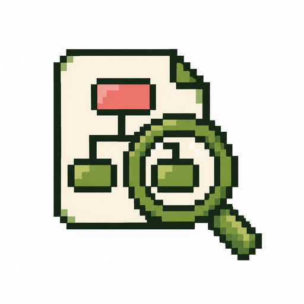
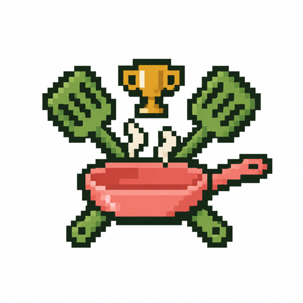
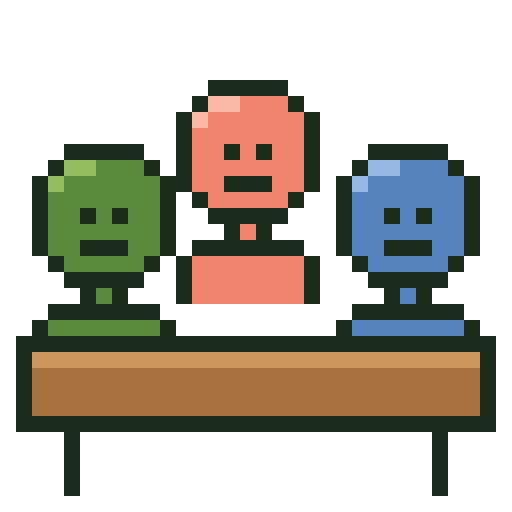
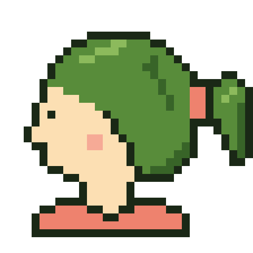

<p align="center"></p>

# guava-stack: AI brain + rules + router

<p align="center"><a href="https://skills.sh/romeodiaz/guava-stack"></a></p>

Your business context, rules, skills and AI memories in one place you already own. Use it from the Claude or ChatGPT app you already have, on any device.

No coding needed: paste the following into Claude or ChatGPT and it sets everything up:

```
Follow the Start here steps in github.com/romeodiaz/guava-stack
```

**🔑 You'll need:**
- Claude  or ChatGPT  plan, or Google AI Pro , or OpenRouter  (pay per use, no plan needed), with the free Claude or ChatGPT app for setup
- Notion (Free) 

**➕ Recommended later:** Grok Bot ($30 plan or higher)  or Muse Bot (Free) , a bot with its own computer that you hand whole jobs to. It turns on the router and can run Claude, ChatGPT, Gemini or OpenRouter's models behind the scenes.

## What you get

### 1) AI brain
<table>
<tr>
<td align="center" width="200"><a href="guava-hub/"></a></td>
<td><ins>guava-hub (Notion)</ins><br>One home in your own Notion workspace for your context, rules, skills and memories. Claude or ChatGPT reads it and remembers into it, and so does any bot or assistant you connect.</td>
</tr>
</table>

Your Notion guava-hub has five parts:

<table>
<tr>
<td align="center" width="200"> <br><strong>context</strong></td>
<td><ins>Your settings and who you are</ins><br>Starts with your guava-stack settings, where guava-router lives: your head-chef and line-cook slots, plus the rules you've turned on. Change a model there and every assistant follows it. Then who you are: your business, customers, offers, voice and tools, filled in from a short interview at setup.</td>
</tr>
</table>

<table>
<tr>
<td align="center" width="200"><br><strong>rules</strong></td>
<td><ins>How your AI works for you</ins><br>Your own rules, plus any rules skill you turn on, such as founder-mode. Each set is saved word for word in its own section, and every assistant follows them.</td>
</tr>
</table>

<table>
<tr>
<td align="center" width="200"><br><strong>skills</strong></td>
<td><ins>What your AI reuses</ins><br>A Notion database of step-by-step instructions your assistants reuse, such as writing a post in your voice or onboarding a client. You choose which ones are on.</td>
</tr>
</table>

<table>
<tr>
<td align="center" width="200"><span style="font-size:64px">🎫</span><br><strong>Tasks</strong></td>
<td><ins>What your AI did</ins><br>Your own Notion Tasks database, now one list for your to-dos and your AI's work. Every piece of work that changes something, or gets handed to another model, gets a row with an ID such as TASK-12, its goal, status and links. The ID goes in commits, PRs, hand-offs and memories, so one search finds the whole trail.</td>
</tr>
</table>

<table>
<tr>
<td align="center" width="200"><br><strong>memories</strong></td>
<td><ins>What your AI learned</ins><br>Notion Memory: the decisions, corrections and preferences your assistants pick up as they work, in one place every assistant shares, so Claude, ChatGPT, Grok Bot, Muse and anything else you connect remember the same things. Each app can move its own memories in, and you can say "forget" anything to remove it.</td>
</tr>
</table>

### 2) rules
<table>
<tr>
<td align="center" width="200"><a href="founder-mode/skills/founder-mode/SKILL.md#the-rules"></a></td>
<td><a href="founder-mode/skills/founder-mode/SKILL.md#the-rules"><ins>founder-mode</ins></a><br>16 commandments. Your AI does the safe work itself, writes like a human, and asks before anything costly or permanent.</td>
</tr>
</table>

### 3) skills
<table>
<tr>
<td align="center" width="200"><a href="guava-hub/skills/workflow-review/SKILL.md"></a></td>
<td><a href="guava-hub/skills/workflow-review/SKILL.md"><ins>workflow-review</ins></a><br>Say "review my workflows". Anytime, from day 1: it asks a few quick questions, then ranks which of your workflows are worth automating, as a polished report that stays on your computer. It gets sharper the longer you use your AI. It's a short version of Guava's $4,000 <a href="https://workwithguava.com/sample-ai-assessment">AI Assessment</a>: no email or sign-up.</td>
</tr>
<tr>
<td align="center" width="200"><a href="https://github.com/blader/humanizer"></a></td>
<td><a href="https://github.com/blader/humanizer"><ins>humanizer-writing</ins></a><br>From blader's humanizer. So anything your AI writes for you doesn't sound like AI. Offered at setup.</td>
</tr>
<tr>
<td align="center" width="200"><a href="guava-hub/skills/design-cook-off/SKILL.md"></a></td>
<td><a href="guava-hub/skills/design-cook-off/SKILL.md"><ins>design-cook-off</ins></a><br>Say "cook-off" when you want a page or screen people will judge by its look, such as a landing page. Your head-chef builds it twice at once, with two design skills, <a href="https://github.com/pbakaus/impeccable">impeccable</a> and <a href="https://github.com/leonxlnx/taste-skill">taste-skill</a>, and you pick the one to build on. Needs Claude Code or Codex (the Claude and ChatGPT apps run them in their Code and Codex tabs), and asks before installing the two design skills.</td>
</tr>
<tr>
<td align="center" width="200"><a href="guava-hub/skills/oracle-council/SKILL.md"></a></td>
<td><a href="guava-hub/skills/oracle-council/SKILL.md"><ins>oracle-council</ins></a><br>Say "ask the council" when you face a hard call. Three top AIs from three companies, GPT-6 Astra, Claude Fable 5.1 and Gemini 4 Argon, answer the same question at once at max effort, and your head-chef merges them into one verdict: where they agree, where they split, and its call on each split. Inspired by <a href="https://github.com/steipete/oracle">oracle</a>. ChatGPT, Claude and Gemini run on your plans (Gemini through Google's Antigravity CLI on Google AI Pro or Ultra), or any seat runs on <a href="https://openrouter.ai">OpenRouter</a>, signed in through your browser, or on a Gemini API key. Needs Claude Code or Codex, or a bot.</td>
</tr>
<tr>
<td align="center" width="200"><a href="https://github.com/DietrichGebert/ponytail"></a></td>
<td><a href="https://github.com/DietrichGebert/ponytail"><ins>ponytail-development</ins></a><br>From Dietrich Gebert's ponytail. When your AI writes or changes code for you, it writes the least code that does the whole job, so there's less to break, review and pay for. Offered at setup if you build things with AI, and turned on in every session where you have Claude Code or Codex.</td>
</tr>
<tr>
<td align="center" width="200"><a href="https://github.com/mvanhorn/last30days-skill"></a></td>
<td><a href="https://github.com/mvanhorn/last30days-skill"><ins>last30days-research</ins></a><br>From Matt Van Horn's last30days. Research what people are actually saying about any topic in the last 30 days, across Reddit, X, YouTube, Hacker News and the web. Comes with a bot, since it runs a program.</td>
</tr>
</table>

### 4) router (upgrade, with a bot)
<table>
<tr>
<td align="center" width="200"><a href="guava-router/"></a></td>
<td><ins>guava-router</ins><br>Once you add Grok Bot or Muse, your bot sends each job to the best AI model on the plans you already pay for, split like a kitchen. Picked from the Pareto-optimal winners on my private benchmarks, <a href="https://workwithguava.com/mainstreetbench#cost-frontier">Main Street Bench</a> and <a href="https://workwithguava.com/mspbench#cost-frontier">MSP Bench</a>.</td>
</tr>
</table>

<!-- models:kitchen size=80 -->
<table>
<tr>
<td align="center" width="50%"><br><strong>head-chef</strong><br><sub>Today's best: Claude Opus 5.5 <br>Next best: GPT-6 Astra </sub></td>
<td align="center" width="50%"><br><strong>line-cook</strong><br><sub>Today's best: GPT-6.1 Sol <br>Next best: Claude Sonnet 5.5 </sub></td>
</tr>
<tr>
<td>Orchestration, research, planning, brainstorming, copywriting, validation, review, verification, fuzzy and hard problems.</td>
<td>Bulk execution, coding, computer use, sub-agent tasks, worker threads, long-running jobs.</td>
</tr>
</table>
<!-- /models -->

## Why people use it
- 🗣️ **Explain your business once.** Every assistant already knows it.
- 💳 **Uses the plans you have.** Claude, ChatGPT or both do the work, or Google AI Pro on its own, or OpenRouter with no plan at all, and Muse is free.
- 📱 **Everywhere.** Works the same in the Claude or ChatGPT app on your desk, laptop and phone.
- 🔓 **No lock-in.** It lives in your own Notion account.
- 🆓 **Free and open source.** MIT licensed.
- 🔒 **Private.** Guava never sees your data.
- 🛡️ **Safe for your AI accounts.** No shared or proxied logins that could get your accounts banned. Each AI runs in its official tool, signed in as you.
- ✅ **Safe by default.** Shows every change first, never overwrites, and checks outside skills before installing.

## Start here
Paste this into the Claude or ChatGPT app:

```
Follow the Start here steps in github.com/romeodiaz/guava-stack
```

It asks for your website and a few details, drafts your hub from them, and checks that everything works, with one yes per step. Unsure? Say "use the defaults".

**⚡ Prefer clicking?** Start your hub from the [Notion template](https://guava-hub.notion.site/guava-hub-400a1a34268a81289479dce72c225c3f), or add the [Grok Bot template](https://x.ai/bot/bp8zbSkrzoJo6wKrv9Eny), then say "set me up".

**➕ Add a bot later:** paste the same line into Grok Bot or Muse. It connects to your hub and turns on the router.

Each app follows its own guide: [Claude](assistants/claude.md) · [ChatGPT](assistants/chatgpt.md) · [Grok Bot](assistants/grok.md) · [Muse](assistants/muse.md).

**AI assistants:** first check `assistants/<your assistant>.md` for steps to skip or change. If there's no file for you, tell the owner Guava doesn't support that assistant yet. Then follow [guava-hub/skills/guava-hub/SKILL.md](guava-hub/skills/guava-hub/SKILL.md) from step 1. It makes the hub, offers founder-mode and starter skills, and wraps up; in a bot, **Add a bot** turns on the router.

**🧩 Just want one piece?** Each works on its own:

```
Install guava-hub from github.com/romeodiaz/guava-stack
```

```
Install founder-mode from github.com/romeodiaz/guava-stack
```

```
Install guava-router from github.com/romeodiaz/guava-stack
```

```
Install oracle-council from github.com/romeodiaz/guava-stack
```

On Grok Bot:

```
npx skills add romeodiaz/guava-stack -g -y
```

For one piece, add `--skill guava-hub` or `founder-mode` or `guava-router` or `oracle-council`.

**▶️ Try it:**
1. "Set me up."
2. "Import my existing instructions and skills into my guava-hub."
3. "Turn on founder-mode."
4. "Write this week's LinkedIn post in my voice."
5. "Review my workflows."

## Some Manual Setup Needed
Setup walks you through each of these, since your AI can't do them for you. If it seems to ignore your hub, check these first:
- **Claude or ChatGPT app:** the lines that start with "Load my guava-hub in Notion first." in [Instructions for Claude](https://claude.ai/new#settings/account) or ChatGPT's [custom instructions](https://chatgpt.com/settings/personalization), in both the ChatGPT and Codex rows.
- **Sign-ins:** you approve Notion in your browser, and with a bot, Claude and ChatGPT too, pasting any code straight back into the bot.
- **Muse:** the lines that start with "Load my guava-hub in Notion first." at the end of SOUL.md (click the bot's avatar, the fingerprint tab, then the SOUL card).
- **Updates:** say "update guava-stack" in each app and bot you use, since only it can change its own instructions.

## How to update
Say **"update guava-stack"** for everything or just **"update guava-hub"**, **"update founder-mode"** or **"update guava-router"** in Claude, ChatGPT, Grok Bot or Muse. It shows the plan first and offers newer models.

## How to uninstall
Say **"uninstall guava-stack"** for everything or just **"uninstall guava-hub"**, **"uninstall founder-mode"** or **"uninstall guava-router"** in Claude, ChatGPT, Grok Bot or Muse. It shows the plan first, removes only what Guava added and leaves your hub in Notion. If your AI doesn't know the command, paste this:

```
Uninstall guava-stack by following the Uninstall steps in github.com/romeodiaz/guava-stack.
```

## Your data stays yours
🔒 Guava collects nothing.

<details>
<summary><strong>See exactly what setup touches</strong></summary>

- **Files edited:** none in the Claude or ChatGPT app. With a bot and the router, on the bot's own computer, `~/.claude/settings.json` and `~/.codex/config.toml`, only for the tools your plans use, each backed up first, with a `.pre-guava` copy kept from before Guava's first change. Setup adds only each tool's model, its Notion connection and approval for Notion's four read-only tools so it can read your hub, never write or delete tools. On OpenRouter alone, Pi keeps the key OpenRouter's sign-in makes in `~/.pi/agent/auth.json`.
- **Commands run:** only with a bot and the router: `npm i -g @anthropic-ai/claude-code`, `npm i -g @openai/codex`, `claude auth login`, `codex login --device-auth` (or, on Google AI Pro alone, Antigravity CLI's install script and its sign-in, or on OpenRouter alone, Pi's install script and OpenRouter's browser sign-in), `claude mcp add` and `codex mcp add` for Notion, and a quick test prompt in each. On Grok Bot, `npx skills add` installs the skills. If you pick ponytail-development where Claude Code or Codex runs, `claude plugin install` and `codex plugin add` install its plugin. If you pick oracle-council, it installs and signs in Google's Antigravity CLI (`agy`) for Gemini, or signs you in to OpenRouter in your browser through Pi, or, only if you'd rather paste one, puts your Gemini API or OpenRouter key in your shell profile (`~/.zshrc` or `~/.bashrc`), backed up first.
- **Files read:** only the instruction, skill or notes files you approve. Never your app's or bot's memories or chats. Each app can move its own memories into Notion Memory if you ask it to.
- **Saved:** your hub, plus standing instructions in Instructions for Claude, custom instructions (ChatGPT), your bot's memory (Grok Bot) or SOUL.md (Muse). The workflow review is a file on your computer, never uploaded. Assistants also save what they learn about your work (decisions, corrections, preferences) to Notion Memory in your own workspace, never passwords or keys. Say "forget" anything to remove it.
- **Undo it all:** "uninstall guava-stack" undoes every change above and keeps your hub, which stays yours to keep or delete. It asks before removing a connector or AI tool you might use for other work.
- **External services:** Notion, your AI providers, GitHub (where your AI reads these steps), npm and pi.dev (to install the tools, with a bot), skills.sh (to check outside skills) and Google or OpenRouter (the router on Google AI Pro or OpenRouter alone, and oracle-council's seats if you add it). Nothing goes to Guava. [Privacy](https://workwithguava.com/privacy)

</details>

## What's inside
- 🧠 **[guava-hub](guava-hub/)**: hub setup, with the [Notion steps](guava-hub/skills/guava-hub/backends/notion.md).
- 🎤 **[founder-mode](founder-mode/)**: the rules and their [changelog](founder-mode/CHANGELOG.md).
- 📋 **[workflow-review](guava-hub/skills/workflow-review/)**: the workflow review and its report template.
- 🍳 **[design-cook-off](guava-hub/skills/design-cook-off/)**: two designed versions of a page to pick from.
- 🏛️ **[oracle-council](guava-hub/skills/oracle-council/)**: three top AIs answer one hard question, merged into one verdict.
- 🔀 **[guava-router](guava-router/)**: model routing through Claude Code and Codex, Antigravity CLI on Google AI Pro alone, or Pi on OpenRouter alone, which your bot runs for you.
- 🤖 **[assistants/](assistants/)**: what Claude, ChatGPT, Grok Bot and Muse each skip or change.

## Support
- ✉️ [romeo@workwithguava.com](mailto:romeo@workwithguava.com)
- 🔒 [Privacy](https://workwithguava.com/privacy)
- 👥 Want it for your whole team? [Book a call](https://workwithguava.com/talk)
- 🛠️ Want a custom guava-stack on Google Drive, Microsoft SharePoint or OneDrive, Obsidian, or your own private AWS or Azure VPC instead of Notion? [Book a call](https://workwithguava.com/talk)

## Credits
Adapted from [poteto-mode](https://github.com/cursor/plugins/blob/main/pstack/skills/poteto-mode/SKILL.md) in Cursor's pstack plugin, by poteto, from [Matt Pocock's skills](https://github.com/mattpocock/skills) and the [humanizer skill](https://github.com/blader/humanizer) by blader. founder-mode takes its name and spirit from Paul Graham's essay [Founder Mode](https://paulgraham.com/foundermode.html), and the Notion hub setup draws on Notion's [Set up Notion for your agent](https://developers.notion.com/prompts/setup).

Built by Romeo Diaz to run Guava ([workwithguava.com](https://workwithguava.com)). Follow @romeodiazai on LinkedIn and X.

## License
MIT. Free to use, change and share. See [LICENSE](LICENSE).
